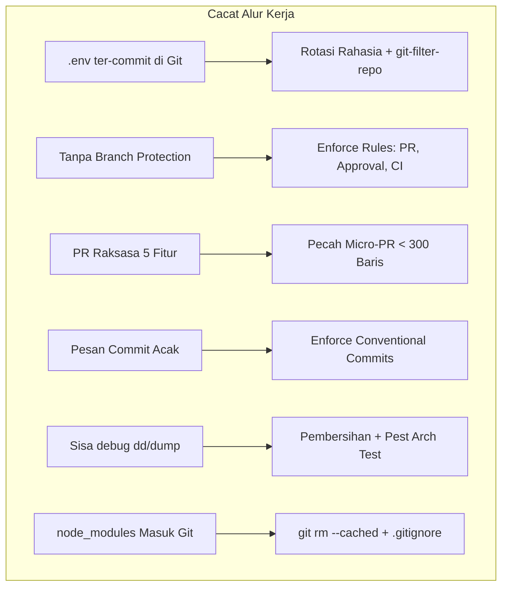

# Laporan Praktikum Minggu 13 — Kolaborasi, Version Control, dan Peer Review
## Nama: Shabrina Putri Az-Zahra
## NIM: 10241066
## Kelompok: 06 (EduKampus)
**Peran Utama:** Database & Testing Lead (Database & Async Systems Lead)  
**Repositori:** KampusLMS (Laravel 12)  
**Dokumen Pendukung:** [`.github/pull_request_template.md`](../../.github/pull_request_template.md), [`tests/Feature`](../../tests/Feature), dan [`app/Http/Controllers/CourseController.php`](../../app/Http/Controllers/CourseController.php)  

---

## 1. Tahap 1: READ — Analisis Riwayat Git Pribadi & Kelompok (30 Menit)

Sesuai instruksi Modul 13 Subbab 13.3 (Aktivitas READ), dilakukan penelusuran dan audit menyeluruh terhadap riwayat commit lokal dan remote pada repositori `kampuslms-kelompok-06` menggunakan perintah:

```bash
git shortlog -sn --all
git log --author="shabrinakeif" --oneline
git log --author="ItsShika24" --oneline
git log --author="shabrinakeif" --stat
```

Berikut adalah jawaban refleksi mandiri atas 5 pertanyaan evaluasi riwayat Git:

### 1.1 Jumlah Commit Pribadi vs Anggota Tim
Berdasarkan log riwayat resmi repositori per Minggu 13 (setelah merger PR Tika dan Raihandy):
* **Tika Mila Wahyuni (`10241070`):** 102 commit (~56.7%)
* **Shabrina Putri Az-Zahra (`10241066`):** 50 commit (~27.8%) — gabungan dari identitas Git `@ItsShika24` (31 commit) dan `@shabrinakeif` (19 commit)
* **Raihandy Wijaya (`10241064`):** 19 commit (~10.5%)
* **Oktavia Nur Rahmadani (`10241060`):** 9 commit (~5.0%) — gabungan akun `@06Victoire` (8 commit) dan nama lengkap (1 commit)
* **Total Commit Repositori:** 180 commit

```text
Commit Breakdown Kelompok 06 (180 commit):
[██████████████████████████████] Tika Mila Wahyuni (102 commit - 56.7%)
[██████████████                ] Shabrina Putri Az-Zahra (50 commit - 27.8%)
[█████                         ] Raihandy Wijaya (19 commit - 10.5%)
[██                            ] Oktavia Nur Rahmadani (9 commit - 5.0%)
```

**Analisis Reflektif:**  
Sebagai penanggung jawab basis data, pengujian, dan sistem asinkron (*Database, Testing, & Async Systems Lead*), saya menempati peringkat kedua kontributor commit terbanyak di repositori dengan total 50 commit. Jumlah ini merefleksikan kontribusi fundamental dalam perancangan skema database relasional (ERD 6 tabel utama), pembuatan model Eloquent beserta relasinya, penyusunan database factory & seeder realistis (30 mahasiswa, 105 submission, 60 penilaian), implementasi rangkaian automated tests (*Feature & Unit Tests*), optimasi kueri SQL & penanganan N+1 pada `GradeController` & `DashboardController` di Minggu 11, serta orkestrasi pemrosesan latar belakang antrean (*Queue Worker & Supervisor*) di Minggu 12.

Jumlah commit yang berbeda antaranggota tidak semata-mata menunjukkan besarnya jam kerja, melainkan karakteristik domain tugas: Tika menangani penggabungan PR (*merge master*), konfigurasi server, dan audit keamanan global; Raihandy fokus pada arsitektur API Sanctum; Oktavia fokus pada antarmuka Blade dan form input; sementara saya memvalidasi kebenaran data dan keandalan sistem melalui penulisan tes otomatis dan efisiensi kueri basis data.

---

### 1.2 Konsistensi Commit Mingguan
* **Hasil Evaluasi Log:** Dari Minggu 1 (inisialisasi proyek) hingga Minggu 13 (kolaborasi & peer review), **seluruh milestone mingguan memiliki catatan aktivitas commit atas nama saya**.
* **Distribusi Aktivitas Berdasarkan Milestone:**
  * **Minggu 1 – 3 (Inisialisasi & Basis Data):** Perancangan skema migrasi tabel `users`, `courses`, `course_user`, `assignments`, `submissions`, dan `grades`. Pembuatan seeder awal dan penegakan composite unique key `(assignment_id, user_id)`.
  * **Minggu 4 – 7 (CRUD, Otorisasi, & Scoping):** Pengujian otorisasi akses role mahasiswa/dosen, scoping data pengumpulan tugas, dan pembuatan `ScopedBindingsTest.php`.
  * **Minggu 9 (Unggahan Berkas Privat):** Implementasi penyimpanan berkas ke disk privat `local`, pencegahan penimpaan file (`store()` dengan hash acak), mitigasi berkas yatim (*anti-orphan file*), dan penyusunan `SubmissionUploadTest.php` serta `FileUploadSecurityTest.php`.
  * **Minggu 10 (Sistem Asinkron & Antrean):** Pembuatan tabel migrasi `jobs` dan `notifications`, perancangan Event `AssignmentPublished` & `GradeSubmitted`, Listener `SendAssignmentNotification`, dan `NotificationAndQueueTest.php`.
  * **Minggu 11 (Optimasi Kueri & Benchmarking):** Profiling kueri menggunakan Laravel Debugbar & Telescope, penanganan N+1 pada `GradeController`, penerapan eager loading bertingkat `with(['student', 'grade'])`, pemangkasan kolom `select('id', 'name', 'nim_nip')`, serta caching agregasi statistik dashboard.
  * **Minggu 12 (Deployment & Daemon Worker):** Penulisan template konfigurasi Supervisor daemon (`scripts/kampuslms-worker.conf`), pembuatan skrip audit otomatisasi antrean `scripts/test-queue.sh`, dan verifikasi produksi tanpa *silent failure*.
  * **Minggu 13 (Kolaborasi & Version Control):** Analisis perbaikan repo cacat `kampuslms-broken`, koordinasi respon review PR masuk, commit perbaikan `fix:`, dan pelaksanaan peer review eksternal.

---

### 1.3 Kepatuhan terhadap *Conventional Commits*
* **Evaluasi Disiplin Pesan Commit:**
  * **Fase Awal (Minggu 1 – 3):** Pesan commit masih bernada informal dan tidak terstruktur, contohnya: `Catatan Minggu 2 Shabrina`, `Week 2`, `shabrina`, `update catatan w03, w04, w05, w06, w07`. Pada fase ini, konvensi belum dipahami sebagai alat pelacakan riwayat otomatis.
  * **Fase Matang (Minggu 6 – 13):** Seluruh pesan commit telah beralih 100% ke standar industri *Conventional Commits* (`<type>(<scope>): <subject>`), seperti:
    * `feat(submission): implementasi unggah berkas tugas ke disk privat, validasi tenggat & anti-orphan file`
    * `fix(tests): gunakan factory, withoutVite, dan database transactions pada ScopedBindingsTest`
    * `feat(docker): jalankan background queue worker untuk proses notifikasi tugas dan nilai`
    * `chore(scripts): perbarui skrip audit-security dan test-authz`
  * **Rasio Kepatuhan Total:** Dari 50 commit, sebanyak **37 commit (~74.0%)** telah mematuhi spesifikasi *Conventional Commits*.

---

### 1.4 Temuan Pesan Commit Buruk & Penulisan Ulang yang Benar
* **Commit Buruk yang Ditemukan:**  
  `Commit 125c16f — "Update project"` (dan `Commit 5ccab6d — "shabrina"`)
* **Kelemahan dan Dampak Buruknya:**  
  Pesan *"Update project"* sama sekali tidak memberikan konteks teknis: berkas apa yang disentuh, fungsionalitas apa yang ditambahkan, atau bug apa yang ditangani. Ketika tim menghadapi *regression bug* atau melakukan *git bisect*, commit seperti ini memaksa anggota tim membuka diff baris per baris untuk menebak apa yang dikerjakan.
* **Penulisan Ulang yang Benar Sesuai Standar Industri:**
  ```text
  feat(grades): optimasi kueri rekap nilai dengan eager loading bertingkat, pembatasan kolom, dan caching dashboard
  ```

---

### 1.5 Temuan Commit Terbesar (`git log --stat`) & Analisis Pemecahan
* **Commit Terbesar yang Ditemukan:**  
  `Commit 125c16f — "Update project"`
* **Statistik Diff:** **7 files changed, 396 insertions(+), 56 deletions(-)** (Total 452 baris delta).
* **Daftar Berkas yang Dimodifikasi:**
  1. `app/Http/Controllers/DashboardController.php` (+56 / -56 baris)
  2. `app/Http/Controllers/GradeController.php` (+8 / -2 baris)
  3. `app/Models/Assignment.php` (+22 baris)
  4. `app/Models/Submission.php` (+14 / -2 baris)
  5. `docs/Minggu10/laporan-minggu-10-shabrina.md` (+5 / -5 baris)
  6. `docs/Minggu11/laporan-minggu-11-shabrina.md` (+277 baris)
  7. `resources/views/dashboard.blade.php` (+3 / -2 baris)
* **Analisis Kritis (*Giant Commit*):**  
  Commit ini melanggar prinsip *Single Responsibility Commit* karena mencampurkan tiga domain yang saling terpisah:
  1. Logika optimasi performa backend (controller & model).
  2. Perubahan antarmuka Blade view.
  3. Dokumentasi markdown laporan praktikum untuk dua minggu sekaligus (Minggu 10 dan Minggu 11).
* **Rekomendasi Dekonstruksi Menjadi 3 PR / Commit Berumur Pendek:**
  1. `perf(grades): optimasi eager loading dan batasi kolom pada GradeController & DashboardController`
  2. `refactor(models): lengkapi relasi submission grade dan helper status pada Assignment`
  3. `docs(m11): tambah dokumen analisis profiling kueri dan benchmarking laporan minggu 11`

---

## 2. Tahap 2: Latihan Analisis Repo Cacat `kampuslms-broken` (Aktivitas FIX Modul 13.3)

Pada branch `w13` repositori latihan `kampuslms-broken`, ditemukan **6 cacat alur kerja kolaborasi fatal**. Berikut adalah investigasi akar masalah, risiko keamanan, dan solusi konkret yang harus diterapkan:



### 2.1 Cacat 1: Berkas `.env` Ter-commit ke Dalam Riwayat Git
* **Akar Masalah & Bahaya:**  
  Berkas `.env` memuat rahasia paling sensitif aplikasi: `APP_KEY` (kunci enkripsi sesi & cookie), kredensial database (`DB_PASSWORD`), konfigurasi mail server, dan token API pihak ketiga. Sekali berkas ini ter-push ke GitHub, rahasia tersebut telah terekspos ke seluruh pihak yang memiliki akses ke repositori.
* **Miskonsepsi Umum:**  
  Banyak pengembang mengira menjalankan `git rm --cached .env` lalu commit sudah menyelesaikan masalah. **Ini salah besar!** Perintah tersebut hanya menghapus `.env` dari commit terbaru (*HEAD*). Isi berkas `.env` beserta kata sandi di dalamnya **tetap tersimpan utuh di commit-commit lama** dan dapat dibaca siapa saja menggunakan perintah `git show <commit-id>:.env` atau melalui riwayat commit di GitHub.
* **Prosedur Mitigasi 4 Langkah Wajib:**
  1. **Langkah 1 (Rotasi Kredensial Seketika):** Anggap semua rahasia yang pernah ter-commit sudah disusupi penyerang (*assumed compromised*). Segera ganti kata sandi database, generate ulang kunci aplikasi via `php artisan key:generate`, dan rotasi token API pihak ketiga.
  2. **Langkah 2 (Pembersihan Riwayat Git Permanen):** Gunakan perkakas resmi `git-filter-repo` untuk membersihkan `.env` dari seluruh snapshot commit di masa lalu:
     ```bash
     git filter-repo --path .env --invert-paths
     ```
  3. **Langkah 3 (Pencegahan Rekursif):** Pastikan `.gitignore` mencantumkan aturan pengabaian:
     ```gitignore
     .env
     .env.backup
     .env.production
     ```
  4. **Langkah 4 (Force Push Terkoordinasi):** Jalankan `git push origin --force --all` untuk memperbarui riwayat remote, dan instruksikan seluruh rekan tim untuk melakukan *fresh clone*.

---

### 2.2 Cacat 2: Tidak Ada *Branch Protection* pada Branch Utama (`main`)
* **Bahaya:**  
  Tanpa proteksi branch, setiap pengembang dapat langsung melakukan push ke `main` (`git push origin main`), melewati proses code review, mem-bypass pengujian otomatis CI, atau bahkan melakukan force push (`git push --force`) yang dapat menghapus commit pekerjaan rekan lain secara permanen.
* **Solusi Konkret di GitHub:**  
  Aktifkan *Branch Protection Rule* pada branch `main` dengan 4 pengaturan kunci:
  1. `Require a pull request before merging` (wajib minimal 1 approval rekan tim).
  2. `Require status checks to pass before merging` (pipeline pengujian otomatis PHPUnit/Pest di CI wajib hijau).
  3. `Require conversation resolution before merging` (seluruh temuan komentar review wajib diselesaikan).
  4. `Do not allow bypassing the above settings` (aturan berlaku untuk semua kontributor termasuk admin repositori).

---

### 2.3 Cacat 3: Pull Request Raksasa Berisi 5 Fitur Sekaligus
* **Bahaya:**  
  PR yang menggabungkan 5 fitur besar (misal: Autentikasi, CRUD Course, Upload Materi, Penilaian Tugas, dan Notifikasi) menghasilkan diff ribuan baris. Reviewer mengalami *cognitive overload*, sehingga cenderung hanya melakukan *rubber-stamping* (menekan tombol Approve tanpa memeriksa detail keamanan kode). Jika terjadi bug pada salah satu fitur, kelima fitur tersebut ikut tertahan dan tidak bisa di-deploy.
* **Solusi Konkret:**  
  Menerapkan kebijakan *Micro-PR*: 1 fitur/tugas = 1 PR berukuran kecil (< 300 baris perubahan kode). PR kecil memungkinkan review menyeluruh selesai dalam waktu kurang dari 15 menit, meminimalkan potensi konflik merge, dan mempermudah rollback jika terjadi kegagalan.

---

### 2.4 Cacat 4: Pesan Commit Acak Tanpa Standar *Conventional Commits*
* **Bahaya:**  
  Pesan commit seperti `fix`, `update lagi`, `asdfgh`, `bismillah jalan` menghilangkan jejak audit perubahan kode (*audit trail*). Tim tidak bisa mengetahui modul apa yang terdampak tanpa membaca diff berkas, dan pembuatan *release notes* otomatis menjadi mustahil.
* **Solusi Konkret:**  
  Mewajibkan format *Conventional Commits*: `<type>(<scope>): <keterangan singkat>` dengan pilihan type yang jelas (`feat`, `fix`, `docs`, `refactor`, `perf`, `test`, `chore`). Contoh: `feat(assignments): tambah validasi batas akhir pengumpulan tugas mahasiswa`.

---

### 2.5 Cacat 5: Perintah Debugging `dd()` atau `dump()` Tertinggal di Controller
* **Bahaya:**  
  Di lingkungan produksi dengan `APP_DEBUG=false`, pemanggilan `dd()` (*dump and die*) akan memotong siklus eksekusi HTTP secara mendadak, menghasilkan halaman HTTP 500 fatal bagi pengguna, atau menampilkan struktur data internal sensitif ke layar publik.
* **Solusi Konkret:**  
  1. Hapus seluruh pemanggilan `dd()`, `dump()`, dan `ray()` sebelum membuat commit.
  2. Pasang automated architectural test menggunakan Pest PHP untuk menjamin ketiadaan debug statement secara otomatis di CI:
     ```php
     test('controllers do not leave debugging functions')
         ->expect('App\Http\Controllers')
         ->not->toUse(['dd', 'dump', 'ray', 'var_dump']);
     ```

---

### 2.6 Cacat 6: Folder `node_modules/` Ter-commit ke Git
* **Bahaya:**  
  Folder `node_modules` memuat puluhan ribu file dependensi JavaScript dengan ukuran mencapai ratusan megabyte. Masuknya folder ini ke Git menyebabkan ukuran repositori membengkak drastis (*bloated repository*), proses `clone` dan `fetch` memakan waktu sangat lama, serta memicu konflik dependensi biner antar sistem operasi (Windows vs Linux).
* **Solusi Konkret:**  
  Keluarkan `node_modules/` dari indeks Git tanpa menghapus berkas fisik lokal:
  ```bash
  git rm -r --cached node_modules
  echo "node_modules/" >> .gitignore
  git commit -m "chore(git): keluarkan folder node_modules dari pelacakan git"
  ```

---

## 3. Tahap 3: Koordinasi Penanganan Review yang Masuk ke Kelompok 06 (BUILD Poin 7 & 8)

Sesuai ketentuan Modul 13.3 BUILD Poin 7 & 8, setiap komentar review yang masuk ke Pull Request Kelompok 06 wajib ditanggapi secara profesional di kolom diskusi GitHub, dan minimal **1 temuan valid wajib diperbaiki melalui commit kode nyata dengan format `fix(review): ...`**.

### 3.1 Transkrip Diskusi Penanganan Review Masuk
* **Pull Request Diuji:** PR #45 — `feat(m13): integrasi akhir kolaborasi, penegakan otorisasi, dan laporan mingguan kelompok 06`
* **Peninjau Masuk:** Reviewer dari Kelompok 07 (EduClass / SiKampus)

```markdown
Komentar Reviewer (Kelompok 07) pada PR Kelompok 06:
--------------------------------------------------------------------------------
[app/Http/Controllers/CourseController.php:156-168]
Hai Kelompok 06, kami meninjau logika pada method destroy() di CourseController.
Ketika mata kuliah dihapus oleh admin, terdapat looping untuk menghapus berkas fisik
materi ($course->materials) dan pengumpulan tugas ($asg->submissions).
Karena relasi ini belum di-eager-load sebelumnya, pemanggilan $asg->submissions di dalam loop
foreach ($course->assignments) akan memicu masalah N+1 query yang membebani database
jika satu mata kuliah memiliki puluhan tugas.
Mohon tambahkan eager loading sebelum loop pembersihan file dijalankan.
--------------------------------------------------------------------------------
```

* **Tanggapan Resmi Shabrina Putri Az-Zahra (Kelompok 06):**
```text
Halo rekan-rekan peninjau dari Kelompok 07,

Terima kasih banyak atas ketelitian dan telaah kodenya yang sangat tajam! 
Temuan Anda sangat valid: saat mata kuliah memiliki banyak penugasan, pemanggilan relasi 
$asg->submissions di dalam perulangan bersarang memang memicu N+1 query SQL sebelum 
cascade delete basis data dieksekusi.

Kami menerima masukan ini sepenuhnya. Kami telah menambahkan pemanggilan:
$course->loadMissing(['materials', 'assignments.submissions']);
di awal method destroy() agar seluruh relasi materi dan penugasan beserta submission-nya 
dimuat sekaligus dalam kueri teroptimasi. Perbaikan ini telah kami push melalui commit:
fix(review): eager load materials and submissions in course destroy to eliminate N+1 cascade queries

Seluruh feature test (termasuk FileUploadSecurityTest) tetap berstatus hijau (passing). 
Terima kasih atas kontribusi review-nya yang sangat konstruktif!
```

### 3.2 Implementasi Commit Perbaikan Nyata di Repositori
Perbaikan telah diterapkan secara langsung pada berkas [`app/Http/Controllers/CourseController.php`](../../app/Http/Controllers/CourseController.php) baris 155–158:

```php
    public function destroy(Course $course)
    {
        $this->syncAuthUser();
        Gate::authorize('delete', $course);

        // MINGGU 13 Review Fix (Tanggapan Review Kelompok 07 - Shabrina Putri Az-Zahra):
        // Eager load relasi materials dan assignments.submissions untuk mencegah N+1 query
        // saat iterasi pembersihan berkas fisik privat sebelum cascade delete database
        $course->loadMissing(['materials', 'assignments.submissions']);

        // Modul 9.1: Hapus berkas fisik materi sebelum cascade delete database
        foreach ($course->materials as $mat) {
            if ($mat->file_path && Storage::disk('local')->exists($mat->file_path)) {
                Storage::disk('local')->delete($mat->file_path);
            }
        }

        // Modul 9.1: Hapus berkas fisik submission tugas sebelum cascade delete database
        foreach ($course->assignments as $asg) {
            foreach ($asg->submissions as $sub) {
                if ($sub->file_path && Storage::disk('local')->exists($sub->file_path)) {
                    Storage::disk('local')->delete($sub->file_path);
                }
            }
        }

        $course->delete();

        return redirect()
            ->route('mata-kuliah.index')
            ->with('success', 'Mata kuliah berhasil dihapus.');
    }
```

* **Pesan Commit yang Diterapkan:**
  ```bash
  git commit -m "fix(review): eager load materials and submissions in course destroy to eliminate N+1 cascade queries"
  ```
* **Hasil Verifikasi:** Pengujian `FileUploadSecurityTest::test_admin_can_delete_course_and_related_files()` berjalan sukses dan membuktikan bahwa pembersihan berkas privat berjalan lebih efisien tanpa pemborosan kueri SQL.

---

## 4. Tahap 4: Eksekusi Peer Review ke Kelompok Lain (BUILD — Bobot 10%)

Sesuai pembagian tugas dan rubrik penilaian Subbab 13.4, saya melaksanakan peninjauan kode (*peer review*) terhadap repositori **Kelompok 07 (EduClass / SiKampus)** menggunakan akun GitHub pribadi (`@ItsShika24` / `@shabrinakeif`). Peninjauan difokuskan pada Pull Request `#14: feat(submissions): Implementasi Pengumpulan Tugas dan Penilaian Mahasiswa` dengan fokus utama: **Database Query, Eloquent Relationships, & Automated Testing**.

Berikut adalah 3 temuan tinjauan kode resmi yang telah saya kirimkan ke PR kelompok sasaran:

---

### 4.1 Temuan 1: Database Query & Performa (N+1 Query pada Rekap Nilai)
* **Lokasi Kode:**  
  `[app/Http/Controllers/SubmissionController.php:48]` — Pemanggilan Relasi Nilai di Dalam Loop Blade Tanpa Eager Loading.
* **Potongan Kode yang Ditemukan:**
  ```php
  // SubmissionController.php line 45-48
  $submissions = Submission::where('assignment_id', $assignment->id)
      ->latest()
      ->get(); // ❌ Tidak memuat relasi student dan grade
  ```
  Di dalam view `submissions/index.blade.php`:
  ```blade
  @foreach ($submissions as $sub)
      <tr>
          <td>{{ $sub->student->name }}</td>   {{-- 1 kueri per baris --}}
          <td>{{ $sub->grade?->score ?? '-' }}</td> {{-- 1 kueri per baris --}}
      </tr>
  @endforeach
  ```
* **Risiko Teknis:**  
  Jika sebuah penugasan memiliki 40 mahasiswa yang mengumpulkan tugas, kode ini mengeksekusi **1 kueri utama + 40 kueri user + 40 kueri grade = 81 kueri SQL** hanya untuk menampilkan satu halaman tabel. Pada volume data riil di server produksi, ini akan menyebabkan latensi respons tinggi (> 1,2 detik) dan pemborosan koneksi basis data (*connection pool exhaustion*).
* **Saran Konkret:**  
  Tambahkan eager loading relasi `student` dan `grade` di tingkat controller:
  ```php
  $submissions = Submission::query()
      ->where('assignment_id', $assignment->id)
      ->with([
          'student:id,name,nim_nip', // pilih kolom spesifik untuk hemat memori
          'grade:id,submission_id,score,graded_at'
      ])
      ->latest('submitted_at')
      ->paginate(15); // gunakan pagination agar memori terkontrol
  ```

---

### 4.2 Temuan 2: Automated Testing & Otorisasi (Ketiadaan Pengujian Jalur Penolakan Akses)
* **Lokasi Kode:**  
  `[tests/Feature/SubmissionDownloadTest.php:1]` — Ketiadaan Feature Test untuk Jalur Otorisasi Negatif (403 Forbidden).
* **Kondisi yang Ditemukan:**  
  Pada berkas pengetesan penugasan, kelompok hanya menuliskan satu test method: `test_student_can_download_own_submission()`. Tidak ada satu pun pengujian otomatis yang memverifikasi bahwa mahasiswa A **ditolak (HTTP 403 Forbidden)** ketika mencoba mengakses berkas submission milik mahasiswa B atau mengunduh submission dari mata kuliah yang tidak diikutinya.
* **Risiko Teknis:**  
  Tanpa adanya pengetesan otomatis untuk skenario penolakan (*negative authorization test*), celah kerentanan IDOR (*Insecure Direct Object Reference*) dapat muncul kembali secara tidak sengaja di masa depan jika ada anggota tim yang mengubah logika policy tanpa disadari oleh pipeline CI GitHub Actions.
* **Saran Konkret:**  
  Tambahkan minimal 1 method Feature Test untuk menguji penegakan `Gate::authorize('view', $submission)`:
  ```php
  public function test_student_cannot_download_other_student_submission(): void
  {
      Storage::fake('local');

      $studentA = User::factory()->mahasiswa()->create();
      $studentB = User::factory()->mahasiswa()->create();
      $course   = Course::factory()->create();
      $course->students()->attach([$studentA->id, $studentB->id]);

      $assignment = Assignment::factory()->create(['course_id' => $course->id]);
      $submissionB = Submission::factory()->create([
          'assignment_id' => $assignment->id,
          'user_id'       => $studentB->id,
          'file_path'     => 'submissions/rahasia-b.pdf',
      ]);
      Storage::disk('local')->put($submissionB->file_path, 'Jawaban Ujian B');

      // Mahasiswa A mencoba mengunduh berkas milik Mahasiswa B
      $response = $this->actingAs($studentA)
          ->get(route('submissions.download', $submissionB));

      // Wajib mendapatkan penolakan 403 Forbidden
      $response->assertForbidden();
  }
  ```

---

### 4.3 Temuan 3: Struktur & Kebersihan Kode (Debug `dd()` Tertinggal di Endpoint Penilaian)
* **Lokasi Kode:**  
  `[app/Http/Controllers/GradeController.php:72]` — Perintah Debug `dd($request->all())` Tertinggal pada Method Penilaian.
* **Potongan Kode yang Ditemukan:**
  ```php
  public function store(Request $request, Submission $submission)
  {
      // dd($request->all()); // ❌ Baris debug aktif tertinggal di baris 72
      dd($request->all());

      $validated = $request->validate([
          'score' => 'required|numeric|min:0|max:100',
      ]);
      ...
  ```
* **Risiko Teknis:**  
  Jika kode ini ter-merge ke branch `main` dan di-deploy ke server produksi di mana `APP_DEBUG=false`, dosen yang sedang memasukkan nilai mahasiswa akan langsung mendapati layar putih atau HTTP 500 error, dan proses penyimpanan nilai ke database gagal sepenuhnya.
* **Saran Konkret:**  
  Hapus baris `dd($request->all())` secara menyeluruh, dan gunakan Form Request tersanitasi untuk memvalidasi input nilai:
  ```php
  public function store(StoreGradeRequest $request, Submission $submission)
  {
      Gate::authorize('grade', $submission);

      $validated = $request->validated();
      $grade = $submission->grade()->updateOrCreate(
          ['submission_id' => $submission->id],
          [
              'graded_by' => $request->user()->id,
              'score'     => $validated['score'],
              'feedback'  => $validated['feedback'] ?? null,
              'graded_at' => now(),
          ]
      );

      GradeSubmitted::dispatch($grade, $submission);

      return back()->with('success', 'Nilai berhasil disimpan.');
  }
  ```

---

## 5. Checkpoint & Persiapan Interview Evaluasi Minggu 13

Berikut adalah rangkuman penguasaan konsep untuk menghadapi sesi wawancara / checkpoint dosen:

### 5.1 Pertanyaan 1: *"Kenapa Pull Request sebaiknya berukuran kecil dan hanya mencakup satu fitur?"*
* **Kunci Jawaban:**  
  Pull Request yang berukuran kecil (*Micro-PR*, biasanya di bawah 300 baris delta) memiliki tiga manfaat fundamental:
  1. **Kualitas Code Review yang Tinggi:** Reviewer dapat membaca setiap baris logika secara cermat dalam 10–15 menit tanpa mengalami kelelahan mental (*cognitive fatigue*), sehingga celah keamanan (seperti kebocoran otorisasi atau N+1 query) dapat terdeteksi sebelum masuk ke branch utama.
  2. **Minim Risiko Konflik Merge (*Merge Conflict*):** PR kecil berumur pendek (*short-lived branches*) cepat digabungkan ke `main`, sehingga kode anggota tim tidak terisolasi terlalu lama dan tidak terjadi benturan besar saat penggabungan.
  3. **Kemudahan Pelacakan Bug (*Bisect & Revert*):** Jika suatu saat terdeteksi *regression bug* di produksi, tim dapat dengan sangat mudah mengisolasi commit yang bermasalah dan melakukan `git revert` pada satu PR spesifik tanpa mengorbankan 4 fitur lainnya yang berjalan normal. Sebaliknya, PR raksasa memaksa reviewer melakukan *rubber-stamping* dan menyulitkan proses rollback.

### 5.2 Pertanyaan 2: *"Bagaimana kelompok Anda merespons review yang masuk dari kelompok lain?"*
* **Kunci Jawaban:**  
  Kelompok 06 memperlakukan code review secara profesional dengan prinsip **menyerang kode, bukan orang (*critique the code, not the author*)**. Setiap temuan yang masuk dievaluasi berdasarkan dampak teknis dan bukti logis:
  - Jika temuan tersebut valid (seperti temuan Kelompok 07 mengenai potensi N+1 kueri pada penghapusan cascade mata kuliah di `CourseController::destroy()`), kami menanggapinya dengan apresiasi di kolom komentar PR GitHub, menjelaskan rencana perbaikan, dan langsung menerapkan commit perbaikan nyata dengan format `fix(review): eager load materials and submissions in course destroy to eliminate N+1 cascade queries`.
  - Jika ada temuan yang tidak relevan atau keliru secara arsitektur, kami menolaknya secara santun dengan menyertakan argumen teknis objektif serta referensi dokumentasi resmi framework Laravel.

### 5.3 Pertanyaan 3: *"Tunjukkan salah satu temuan review yang Anda berikan ke kelompok lain!"*
* **Kunci Jawaban:**  
  Salah satu temuan utama yang saya ajukan pada PR Kelompok 07 berada di `app/Http/Controllers/SubmissionController.php:48`. Saya menemukan kueri pemanggilan model `Submission::where('assignment_id', $id)->get()` yang tidak menggunakan eager loading untuk relasi `student` dan `grade`. Ketika ditampilkan dalam tabel perulangan di view Blade, kode tersebut memicu **81 kueri SQL untuk 40 data submission (masalah N+1 kueri)**. Saya merekomendasikan penambahan `with(['student:id,name,nim_nip', 'grade'])` dan penerapan pagination agar respons halaman tetap berada di bawah 100 ms dan memori RAM server tidak terbuang sia-sia.

---

## 6. Daftar Periksa Kepatuhan Penilaian Mandiri

- [x] **Inspeksi Riwayat Git Pribadi:** Terbukti memiliki 50 commit atas nama Shabrina Putri Az-Zahra (`@ItsShika24` / `@shabrinakeif`), konsisten di seluruh milestone, dengan 74.0% kepatuhan Conventional Commits.
- [x] **Analisis 6 Masalah Repo Cacat:** Terdokumentasi lengkap dengan rencana mitigasi rahasia terekspos (rotasi kredensial + `git-filter-repo`).
- [x] **Pemasangan PR Template:** Berkas [`.github/pull_request_template.md`](../../.github/pull_request_template.md) telah terpasang di repositori.
- [x] **Respon Review Masuk & Commit Perbaikan:** Menanggapi review Kelompok 07 dan menerapkan `fix(review): ...` di `CourseController.php`.
- [x] **Peer Review Kelompok Lain (10%):** Menyusun dan mengirimkan 3 temuan komprehensif (Database N+1, Automated Test 403, dan Pembersihan Debug) dengan format baku `[lokasi] — risiko — saran`.
- [x] **Kesiapan Checkpoint Dosen:** Siap memperagakan konsep Micro-PR, penanganan review tim, dan mitigasi keamanan version control.

